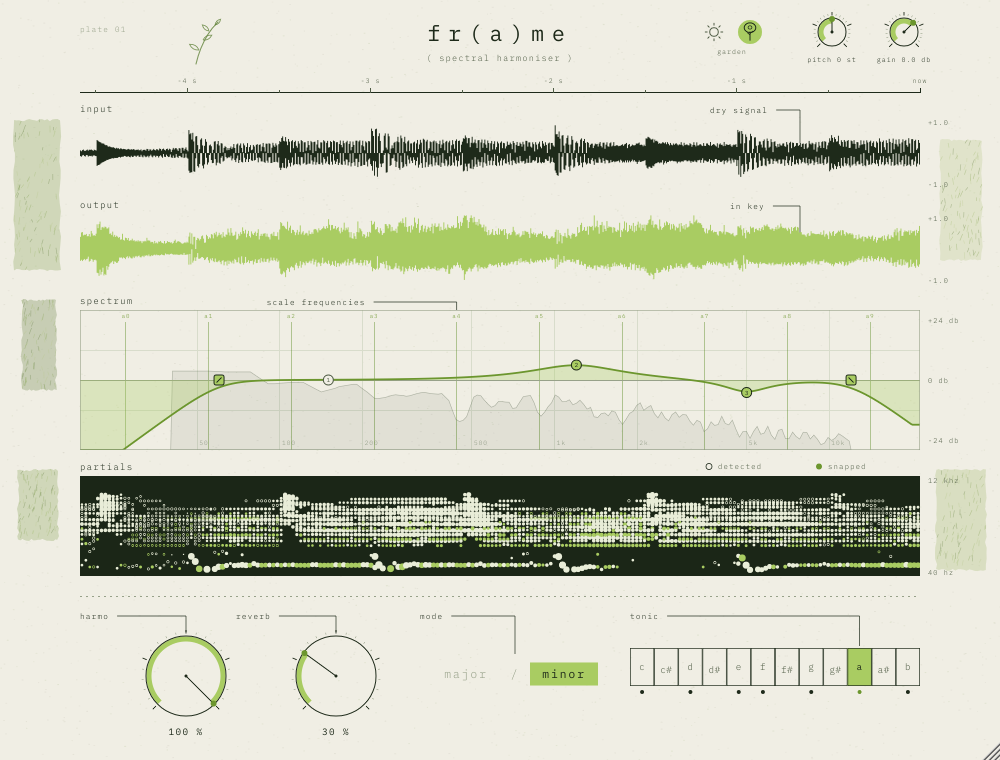
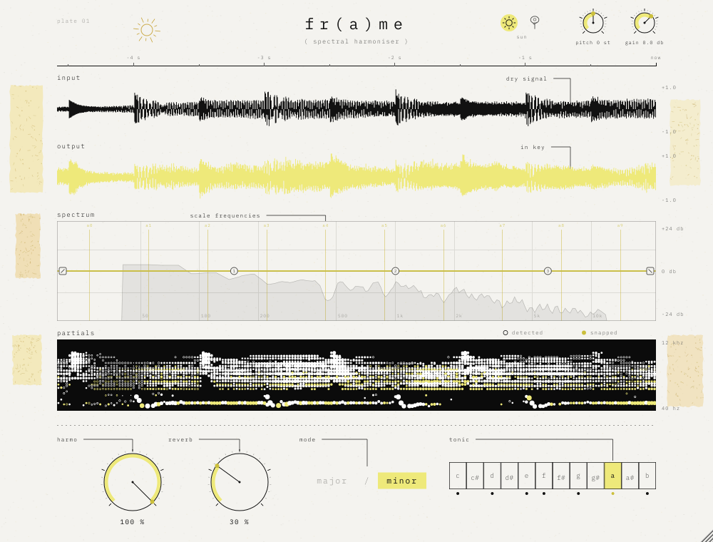

# fr(a)me — harmoniseur spectral

Plugin audio d'effet (VST3 · AU · Standalone) qui colore tout le son dans la gamme choisie
— notes de la gamme renforcées, espace entre elles creusé, harmoniques justes ajoutées —
**sans aucune latence** : l'effet sonne exactement en même temps que le son d'origine.

Contrôles : **harmo** (0–100 %, dose l'harmonie), **reverb** (0–100 %, réverbe ambient granulaire dans la tonalité), **pitch** (−12 … +12 demi-tons, elastic) et **gain** de sortie (−24 … +12 dB), petits boutons en haut à droite, **EQ façon Pro-Q** dans la partie spectrum (coupe basse, 3 cloches, coupe haute ; fréquences de gauche à droite), **thèmes** garden (par défaut) / sun, **mode** (major / minor), **note** (tonique, 12 notes).
Tous automatisables et sauvegardés avec le projet.

| garden (par défaut) | sun |
|---|---|
|  |  |

## Télécharger

Les installeurs macOS et Windows sont compilés automatiquement par GitHub Actions et publiés dans
l'onglet **[Releases](../../releases/latest)** :

| système | fichier |
|---|---|
| macOS 11+ (Apple Silicon & Intel) | `frame-X.Y.Z-macos.pkg` — VST3, AU et Standalone, au choix |
| Windows 10/11 64 bits | `frame-X.Y.Z-windows-setup.exe` — VST3 et Standalone |
| Windows (portable) | `frame-X.Y.Z-windows.zip` |

Les installeurs ne sont pas signés par un certificat développeur payant :

- **macOS** : clic droit sur le `.pkg` ▸ *Ouvrir*, ou *Réglages Système ▸ Confidentialité
  et sécurité ▸ Ouvrir quand même*.
- **Windows** : à l'avertissement SmartScreen, *Informations complémentaires ▸ Exécuter
  quand même*. Le VST3 s'installe dans `C:\Program Files\Common Files\VST3\`.

Chaque push sur `main` recompile tout et met à jour la release `vX.Y.Z`, où X.Y.Z est la
`VERSION` du `project(...)` dans `CMakeLists.txt`. Pour une nouvelle version : changez ce
numéro et poussez (ou poussez un tag `vX.Y.Z`). Les installeurs de chaque run sont aussi
dans *Actions ▸ run ▸ Artifacts*.

Signature optionnelle (macOS) : `installer/macos/build_pkg.sh` signe avec vos identités
Apple si les variables `MACOS_APP_IDENTITY` et `MACOS_INSTALLER_IDENTITY` sont définies
(compte Apple Developer requis ; la notarisation se fait ensuite avec `xcrun notarytool`).

---

## 1. Prérequis

| | macOS | Windows |
|---|---|---|
| Système | macOS 11 ou plus | Windows 10 / 11 (64 bits) |
| Compilateur | Xcode 14+ (avec les *Command Line Tools*) | Visual Studio 2022 (charge de travail « Développement Desktop en C++ ») |
| CMake | 3.22+ (`brew install cmake`) | 3.22+ (inclus dans VS 2022, ou cmake.org) |
| Git | inclus avec Xcode | git-scm.com |

JUCE 8.0.15 est téléchargé automatiquement par CMake au premier lancement
(aucune installation manuelle). Pour travailler hors-ligne, clonez-le dans le dossier
du projet : `git clone --depth 1 --branch 8.0.15 https://github.com/juce-framework/JUCE.git JUCE`.

---

## 2. Compiler pas à pas

### macOS

```bash
cd frame
# 1. Générer le projet (Xcode) — binaire universel Apple Silicon + Intel
cmake -B build -G Xcode
# 2. Compiler en Release
cmake --build build --config Release
```

Résultats dans `build/Frame_artefacts/Release/` :

- `VST3/frame.vst3`
- `AU/frame.component`
- `Standalone/frame.app`

Installation :

```bash
cp -R build/Frame_artefacts/Release/VST3/frame.vst3     ~/Library/Audio/Plug-Ins/VST3/
cp -R build/Frame_artefacts/Release/AU/frame.component  ~/Library/Audio/Plug-Ins/Components/
killall -9 AudioComponentRegistrar 2>/dev/null   # force macOS à relire la liste des AU
auval -v aufx Frm1 Frma                           # validation AU (doit finir par « PASS »)
```

> Logic Pro : relancez Logic après la copie ; le plugin apparaît dans
> *Audio Units ▸ fr(a)me audio ▸ fr(a)me*.
> Pour un ordinateur autre que le vôtre, il faudra signer/notariser les bundles
> (`codesign` + `notarytool`) — inutile pour un usage personnel.

### Windows

Dans **« x64 Native Tools Command Prompt for VS 2022 »** (ou PowerShell) :

```bat
cd frame
:: 1. Générer la solution Visual Studio
cmake -B build -G "Visual Studio 17 2022" -A x64
:: 2. Compiler en Release
cmake --build build --config Release
```

Résultats dans `build\Frame_artefacts\Release\` :

- `VST3\frame.vst3`
- `Standalone\frame.exe`

Installation : copiez le dossier `frame.vst3` dans `C:\Program Files\Common Files\VST3\`
puis relancez un scan des plugins dans votre DAW. (L'AU n'existe que sur macOS.)

### Tester sans DAW

Lancez l'application **Standalone** : *Options ▸ Audio/MIDI Settings* pour choisir
l'entrée (micro, carte son) et la sortie. Pratique pour vérifier l'interface et le son.

### Banc de test du moteur (optionnel)

```bash
cmake -B build-tests -DFRAME_BUILD_TESTS=ON -DCMAKE_BUILD_TYPE=Release
cmake --build build-tests --config Release --target FrameEngineTest
# puis lancer l'exécutable FrameEngineTest (dans build-tests/FrameEngineTest_artefacts/…)
# avec un nom de dossier en argument pour obtenir des WAV avant / après :
#   FrameEngineTest wav
```

Résultats obtenus pendant le développement (48 kHz) :

| test | résultat |
|---|---|
| reconstruction sans recalage (latence déclarée exacte) | erreur à −138 dB |
| la#4 en la mineur → la4 | 440.02 Hz, aucun résidu ajouté |
| 480 Hz (si−49 cents, déjà dans la gamme) | intact, 479.98 Hz |
| changement de gamme pendant la lecture | aucune discontinuité |
| accord de scies désaccordées (pad) | énergie dont le demi-ton est dans la gamme : 66 % → 96 % |
| percussions : enveloppe 2 ms entrée/sortie | corrélation 0.98 (attaques conservées) |
| la3 tenu : harmoniques justes | ×2 à −9 dB, ×3 (mi) à −12 dB, ×4 à −14 dB ; la# hors gamme à −55 dB |
| bruit blanc (la mineur) | notes +6 dB, entre les notes −11 dB, niveau global −0.6 dB |
| salve de bruit, REVERB 70 % puis moteur | queue dans la gamme à 96 %, corrélation G/D 0.07, −39 dB à 1 s → −77 dB à 6 s |
| REVERB 100 % sur 40 s de bruit continu | niveau stable (pas d'emballement du nuage réinjecté) |
| bruit blanc → résonances, la mineur | la / do / mi ≥ −1.3 dB, hors gamme ≤ −18.5 dB, 81 % de l'énergie sur les notes, niveau conservé |
| bruit blanc → résonances, mi majeur | mi / sol# / si ≥ −4.1 dB, hors gamme ≤ −19.3 dB, 80 % sur les notes |
| vos hi-hats, chaîne complète | 90–92 % de l'énergie sur les notes de la gamme, hors gamme −25 à −41 dB, niveau identique |
| PITCH +12 / −12 / +7 / −5 | 440.0 / 110.0 / 329.7 / 164.8 Hz depuis 220 Hz (±0.2 cent) ; 0 = inchangé |
| HARMO à 0 | reverb, pitch et EQ actifs ; tout à 0 → son d'origine (corrélation 0.999) |
| automation brutale HARMO / REVERB / PITCH / EQ / GAIN / gamme | aucune valeur invalide (aussi sous AddressSanitizer, 44.1–96 kHz, blocs de 0 à 3072) |
| taille de bloc variable | sortie identique à l'échantillon près |

Une cible `FrameUiSnapshot` (même option) produit une capture PNG de l'interface.

---

## 3. Organisation du code

```
frame/
├── CMakeLists.txt            projet (JUCE téléchargé automatiquement)
├── Source/
│   ├── PluginProcessor.*     paramètres (APVTS), latence, mix dry/wet, état, bypass
│   ├── SpectralEngine.*      moteur spectral : STFT, vocodeur de phase, recalage, harmoniques, peigne, OLA
│   ├── AmbientReverb.*       réverbe ambient (FDN) + nuage granulaire réinjecté
│   ├── ProEq.*               EQ façon Pro-Q : coupes 24 dB/oct + 3 cloches (0 latence)
│   ├── PitchShifter.*        PITCH : transposition elastic (SOLA)
│   ├── ZeroLatencyHarmonizer.* peigne harmonique + harmoniques justes (0 latence)
│   ├── HarmonicResonator.*   résonances étroites sur les notes de la gamme, pondérées par degré
│   ├── Scale.h               gammes (masque 12 notes) et note la plus proche
│   ├── LockFreeQueue.h       FIFO sans verrou audio → interface
│   ├── PluginEditor.*        la planche : mise en page, annotations, mise à l'échelle
│   ├── Visualisers.*         bandes input / output / spectrum / partials
│   ├── Controls.*            bascule major/minor, rangée des 12 notes, EQ façon Pro-Q (EqView)
│   └── FrameLookAndFeel.*    palette, typographie, potentiomètre
├── Resources/fonts/          IBM Plex Mono (licence SIL OFL, voir OFL.txt)
└── tests/                    banc de test du moteur, capture de l'interface
```

---

## 4. Le traitement en détail

**Analyse.** STFT à fenêtre de Hann, N = 4096 points à 44.1/48 kHz (8192 à 88.2/96 kHz,
16384 au-delà, pour garder ~11 Hz de résolution), recouvrement 75 % (hop = N/4).
L'analyse se fait sur le spectre *mid* (moyenne des canaux) ; le même déplacement est
ensuite appliqué à chaque canal, ce qui préserve l'image stéréo.

**Fréquence réelle des pics.** Vocodeur de phase : l'écart entre la phase mesurée d'un
bin et l'avance attendue entre deux trames donne la fréquence exacte du partiel, bien
plus précise que la largeur d'un bin.

**Recalage phase-locked** (Laroche & Dolson, 1999). Le spectre est découpé en régions
autour de chaque pic (jusqu'aux creux voisins). Pour chaque pic :

1. note cible = note de la gamme la plus proche (A4 = 440 Hz, tempérament égal) ;
2. toute la région est déplacée d'un nombre entier de bins vers la cible ;
3. elle est multipliée par un phaseur e^{jθ}, avec θ accumulé de trame en trame
   (θ += 2π·hop·(f_cible − f_réelle)/fs) le long du même partiel.

La fréquence entendue est donc exactement la cible, et la phase reste cohérente dans
le temps et entre les bins d'un même partiel : pas de son métallique ni de *phasiness*.
Comme on déplace les bins tels quels, l'enveloppe, le souffle et la texture de chaque
partiel voyagent avec lui — on ne resynthétise rien.

**Transitoires.** Seuls les partiels *stables* (suivis d'une trame à l'autre) sont
recalés. Le bruit, les attaques (+6 dB d'une trame à l'autre) et les partiels qui
viennent d'apparaître passent avec leur phase d'origine : kicks, caisses claires et
consonnes restent nets. L'infra-grave (< 25 Hz) et l'extrême aigu (> 16 kHz) ne sont
pas touchés.

**Modèle « Chroma » (mesuré).** Le traitement a été calé en analysant les comparaisons
avant/après de la démo vidéo de Chroma (Xynth) :

- *Recalage par demi-ton* : un partiel dont le demi-ton le plus proche est dans la gamme
  n'est pas touché (son désaccord naturel reste) ; sinon il est déplacé d'un nombre entier
  de demi-tons vers la note de la gamme voisine, en gardant la moitié de son écart en
  cents (mesuré : sol#+41 → la+27, do#−21 → ré−10, la#−19 → la−18).
- *Peigne harmonique* : renfort étroit sur les fréquences des notes de la gamme et creux entre
  elles, de ~250 Hz à 12 kHz, niveau global compensé, sans filtre qui sonne. Sur le même
  extrait passé dans fr(a)me et dans Chroma, l'écart moyen par note est d'environ 1.5 dB
  entre 600 Hz et 4 kHz, pour un niveau identique (−8.0 dB / −8.0 dB).

**Harmonie sans latence (toujours active, dans la lignée de la 1.4).** Depuis la 1.9, le
traitement audio se fait entièrement par filtres, comme un égaliseur en mode « zero
latency » : **0 échantillon de retard** (vérifié : la réponse à un clic culmine au
premier échantillon), FL Studio n'a rien à compenser.

- *Peigne harmonique* : une cascade de cloches étroites (double précision), une sur
  chaque note de la gamme de mi1 à mi8, puis un plateau de compensation dynamique
  (≈ 250 Hz – 9 kHz, boucle fermée) qui ramène le niveau : contraste notes / entre les
  notes ≈ 16 dB, comme la 1.4 poussée d'un cran ; le grave n'est pas touché.
- *Harmoniques justes* : chaque note de la gamme est isolée, son signal analytique
  z = A·e^{jθ} est formé, et ses harmoniques Re(z²)/A, Re(z³)/A², Re(z⁴)/A³ sont
  recréées (octave, douzième si la quinte est dans la gamme, double octave), en phase
  avec la note : ≈ −7 / −9 / −11 dB sous elle. Un détecteur « note centrée » (±50 cents)
  empêche les bandes voisines de fabriquer de fausses harmoniques (son propre).
- Changement de gamme : gains glissés (~120 ms), sans clic.

Le déplacement des notes fausses (vocodeur de phase des versions ≤ 1.8) demande
obligatoirement une analyse avec retard : il n'est plus utilisé pour le son. Le moteur
spectral sert désormais uniquement aux visualisations.

**EQ façon Pro-Q** (2.3, partie spectrum) : fréquences de gauche à droite (20 Hz → 20 kHz),
gain de haut en bas (±24 dB affichés), l'analyseur du son de sortie et les toniques de la
gamme en fond. Cinq points à tirer à la souris : **coupe basse** (carré ⟋, 24 dB/oct),
**3 cloches** (ronds 1 · 2 · 3 : gauche / droite = fréquence, haut / bas = gain ±18 dB,
molette = largeur Q 0.3 … 10) et **coupe haute** (carré ⟍). Double-clic sur un point : remise
à zéro. Coupes en butée et cloches à 0 dB : son strictement inchangé. 0 latence (filtres à
variables d'état), automatisable, placé juste avant le limiteur de sortie. La courbe affichée
correspond au son (cloche +12 dB mesurée à +12.0 dB).

(Le **retune** des versions 2.0 à 2.2 a été retiré en 2.3.)

**HARMO** (ancien MIX, 0–100 %) : dose uniquement le traitement harmonique (peigne +
harmoniques justes) ; à 100 % le son est celui de la 2.0.0. À 0 %, la réverbe, l'EQ,
le pitch et le gain fonctionnent toujours : chaque bouton agit seul, et ensemble ils
s'enchaînent dans cet ordre — reverb → harmo → pitch → gain → EQ — pour que tout ce qui
est ajouté (queue, porteuses) passe dans la gamme.

**PITCH** (−12 … +12 demi-tons, 0 par défaut), façon elastic pitch : la hauteur change, pas
la durée. Deux têtes de lecture fondues, dont le point de reprise est choisi par corrélation
(type SOLA) : transposition exacte (±0.2 cent mesuré à ±12, +7, −5), niveau conservé, pas de
saut de phase. À 0, contourné : son strictement inchangé.

**Thèmes** (en haut à droite) : petit arbre = **garden**, le thème au lancement (verts
mousse, papier chaud, aplats de collage végétal, brin au crayon) ; soleil = **sun** (la
planche jaune de base, avec le même principe de collage en tons solaires et un petit
soleil au crayon). Le thème est sauvegardé avec le projet.

**REVERB** (0–100 %) : vraie réverbe ambient — réseau de 8 lignes à retard en feedback
(matrice de Hadamard), longueurs modulées lentement (queue vivante, pas métallique), aigus
amortis, pré-délai, T60 de 1.5 s à 12 s. Un **nuage granulaire** vit *dans* la réverbe :
des grains de 80 à 350 ms prélevés dans la queue, à l'unisson ou à l'octave (au-dessus ou
en dessous), placés au hasard dans l'espace stéréo, puis réinjectés dans la réverbe où ils
se fondent. La réverbe est placée **avant** le moteur harmonique : toute la queue, grains
compris, est ensuite recalée, harmonisée et peignée → une réverbe entièrement dans la
tonalité. Niveau normalisé : la queue ne s'emballe pas, même à 100 % sur un son tenu.

**Particules (1.9)** : nuage plus dense (6 → 46 grains/s), éclats courts (30–90 ms) et
grains longs (120–420 ms), unisson / octave / double octave au-dessus / octave en dessous,
diffusion propre, filtre anti-repliement ; réinjection dans la réverbe stable par
construction (seules les particules transposées reviennent dans la boucle, énergie
plafonnée par rapport au son entrant). Niveau de la réverbe calé sur la 1.4.

**Limiteur de sortie** : gain lissé lié en stéréo (attaque immédiate, relâchement
120 ms, plafond −0.5 dBFS) au lieu d'un écrêtage : plus de grésillement près de 0 dB.

**Garde-fou « tout le son passe »** : le plugin compare en continu l'énergie du son
traité à celle du son d'origine (aligné). Si le traité tombe à plus de 6 dB sous
l'original alors que celui-ci joue, le son direct est réinjecté automatiquement (en ~30 ms,
retrait en ~600 ms) : aucune partie du son ne peut disparaître, quel que soit l'hôte. En
usage normal il ne s'active jamais (vérifié : 0 bloc actif sur des hi-hats et 60 s de
musique) ; sur une perte simulée de 30 dB, il rétablit le niveau d'origine. (Depuis la 2.2,
le pied de page est retiré : la planche reste épurée.)

**Sécurité** : entrée et sortie assainies (aucune valeur invalide ne peut sortir ni
contaminer le mixeur de l'hôte), auto-réinitialisation du moteur si besoin, limiteur doux
transparent sous −1 dBFS qui plafonne la sortie à 0 dBFS, appels de l'hôte avant
`prepareToPlay` ou avec des blocs vides gérés.

**Resynthèse.** IFFT, fenêtre de synthèse de Hann, overlap-add normalisé
(reconstruction parfaite quand rien n'est déplacé).

**Latence.** Aucune (0 échantillon) depuis la 1.9. Le signal sec est retardé
d'autant, si bien que le MIX ne crée jamais de filtrage en peigne. En bypass, la
latence est conservée.

**Sans clic.** MIX lissé sur 50 ms ; un changement de gamme est fondu sur ~100 ms
(les cibles glissent d'une note à l'autre, θ reste continu).

**Temps réel.** Toute la mémoire est allouée dans `prepareToPlay`. Le thread audio
n'alloue rien et ne prend aucun verrou ; les formes d'onde et les trames spectrales
partent vers l'interface par deux `LockFreeQueue` (juce::AbstractFifo). Coût mesuré :
environ 2.5 % d'un cœur en stéréo à 48 kHz (build Release).

---

## 5. L'interface

Une planche d'analyse de 1000 × 760 unités, dessinée en vectoriel et mise à l'échelle
(720 px de large par défaut ; redimensionnez par le coin inférieur droit, de 520 à 1500 px).

- **input** : forme d'onde noire du signal entrant ;
- **output** : forme d'onde jaune du signal traité ;
- **spectrum** : spectrogramme défilant à l'encre, grain d'impression ; les lignes des
  fréquences de la gamme sont teintées, l'énergie qui tombe dessus s'imprime en jaune ;
  à gauche, la tonique de chaque octave ;
- **partials** : partition graphique noire, un rond par pic détecté (taille = amplitude),
  jaune si le pic a été recalé ;
- **harmo** (double-clic = 100 %), **reverb** (double-clic = 30 %), **pitch** (double-clic = 0), **gain** (double-clic = 0 dB), **mode** (clic sur le mot), **tonic** (clic ou glisser
  le long de la rangée ; un point marque chaque note de la gamme).

Les quatre bandes partagent le même axe temporel (~9 s, « now » à droite).

---

## 6. Personnaliser

- Couleurs : `Palette` dans `Source/FrameLookAndFeel.h`.
- Taille de FFT : `SpectralEngine::prepare` (plus grand = graves plus précis mais plus
  de latence et d'étalement temporel).
- Seuil « stable / attaque » : section 5 de `SpectralEngine::processFrame`.
- Mineur = mineur naturel (éolien) ; les gammes sont définies dans `Source/Scale.h`.
