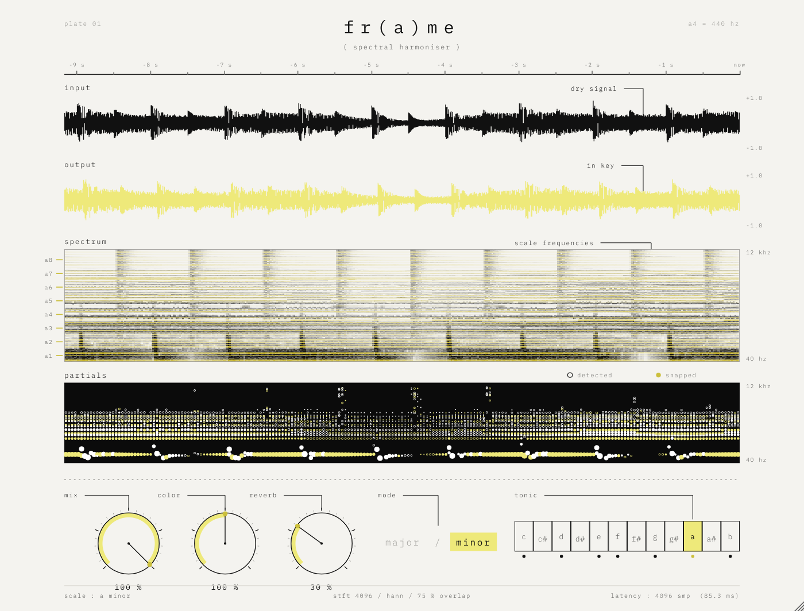

# fr(a)me — harmoniseur spectral

Plugin audio d'effet (VST3 · AU · Standalone) qui recale en temps réel chaque fréquence
hors tonalité sur la note la plus proche de la gamme choisie, sans resynthèse : timbre,
transitoires et texture d'origine sont conservés, seule l'harmonie est corrigée.

Cinq contrôles : **mix** (0–100 %), **color** (0–200 %, comme sur Chroma), **reverb** (0–100 %, réverbe harmonique + particules), **mode** (major / minor), **note** (tonique, 12 notes).
Tous automatisables et sauvegardés avec le projet.



## Télécharger

L'installeur macOS est compilé automatiquement par GitHub Actions et publiés dans
l'onglet **[Releases](../../releases/latest)** :

| système | fichier |
|---|---|
| macOS 11+ (Apple Silicon & Intel) | `frame-X.Y.Z-macos.pkg` — VST3, AU et Standalone, au choix |

L'installeur n'est pas signé par un certificat développeur payant : clic droit sur le
`.pkg` ▸ *Ouvrir*, ou *Réglages Système ▸ Confidentialité et sécurité ▸ Ouvrir quand même*.

Chaque push sur `main` recompile tout et met à jour la release `vX.Y.Z`, où X.Y.Z est la
`VERSION` du `project(...)` dans `CMakeLists.txt`. Pour une nouvelle version : changez ce
numéro et poussez (ou poussez un tag `vX.Y.Z`). Les installeurs de chaque run sont aussi
dans *Actions ▸ run ▸ Artifacts*.

Signature optionnelle (macOS) : `installer/macos/build_pkg.sh` signe avec vos identités
Apple si les variables `MACOS_APP_IDENTITY` et `MACOS_INSTALLER_IDENTITY` sont définies
(compte Apple Developer requis ; la notarisation se fait ensuite avec `xcrun notarytool`).

---

## 1. Prérequis

| | macOS | Windows |
|---|---|---|
| Système | macOS 11 ou plus | Windows 10 / 11 (64 bits) |
| Compilateur | Xcode 14+ (avec les *Command Line Tools*) | Visual Studio 2022 (charge de travail « Développement Desktop en C++ ») |
| CMake | 3.22+ (`brew install cmake`) | 3.22+ (inclus dans VS 2022, ou cmake.org) |
| Git | inclus avec Xcode | git-scm.com |

JUCE 8.0.15 est téléchargé automatiquement par CMake au premier lancement
(aucune installation manuelle). Pour travailler hors-ligne, clonez-le dans le dossier
du projet : `git clone --depth 1 --branch 8.0.15 https://github.com/juce-framework/JUCE.git JUCE`.

---

## 2. Compiler pas à pas

### macOS

```bash
cd frame
# 1. Générer le projet (Xcode) — binaire universel Apple Silicon + Intel
cmake -B build -G Xcode
# 2. Compiler en Release
cmake --build build --config Release
```

Résultats dans `build/Frame_artefacts/Release/` :

- `VST3/frame.vst3`
- `AU/frame.component`
- `Standalone/frame.app`

Installation :

```bash
cp -R build/Frame_artefacts/Release/VST3/frame.vst3     ~/Library/Audio/Plug-Ins/VST3/
cp -R build/Frame_artefacts/Release/AU/frame.component  ~/Library/Audio/Plug-Ins/Components/
killall -9 AudioComponentRegistrar 2>/dev/null   # force macOS à relire la liste des AU
auval -v aufx Frm1 Frma                           # validation AU (doit finir par « PASS »)
```

> Logic Pro : relancez Logic après la copie ; le plugin apparaît dans
> *Audio Units ▸ fr(a)me audio ▸ fr(a)me*.
> Pour un ordinateur autre que le vôtre, il faudra signer/notariser les bundles
> (`codesign` + `notarytool`) — inutile pour un usage personnel.

### Windows

Dans **« x64 Native Tools Command Prompt for VS 2022 »** (ou PowerShell) :

```bat
cd frame
:: 1. Générer la solution Visual Studio
cmake -B build -G "Visual Studio 17 2022" -A x64
:: 2. Compiler en Release
cmake --build build --config Release
```

Résultats dans `build\Frame_artefacts\Release\` :

- `VST3\frame.vst3`
- `Standalone\frame.exe`

Installation : copiez le dossier `frame.vst3` dans `C:\Program Files\Common Files\VST3\`
puis relancez un scan des plugins dans votre DAW. (L'AU n'existe que sur macOS.)

### Tester sans DAW

Lancez l'application **Standalone** : *Options ▸ Audio/MIDI Settings* pour choisir
l'entrée (micro, carte son) et la sortie. Pratique pour vérifier l'interface et le son.

### Banc de test du moteur (optionnel)

```bash
cmake -B build-tests -DFRAME_BUILD_TESTS=ON -DCMAKE_BUILD_TYPE=Release
cmake --build build-tests --config Release --target FrameEngineTest
# puis lancer l'exécutable FrameEngineTest (dans build-tests/FrameEngineTest_artefacts/…)
# avec un nom de dossier en argument pour obtenir des WAV avant / après :
#   FrameEngineTest wav
```

Résultats obtenus pendant le développement (48 kHz) :

| test | résultat |
|---|---|
| reconstruction sans recalage (latence déclarée exacte) | erreur à −138 dB |
| la#4 en la mineur → la4 | 440.02 Hz, aucun résidu ajouté |
| 480 Hz (si−49 cents, déjà dans la gamme) | intact, 479.98 Hz |
| changement de gamme pendant la lecture | aucune discontinuité |
| accord de scies désaccordées (pad), COLOR 100 % | énergie dont le demi-ton est dans la gamme : 66 % → 95 % |
| percussions : enveloppe 2 ms entrée/sortie | corrélation 0.98 (attaques conservées) |
| la4 tenu (la mineur) : octave / quinte / tierce ajoutées | −25 / −26 / −29 dB ; la# hors gamme à −67 dB |
| queue de résonance après l'arrêt (COLOR 200 %) | −27 dB à 0.5 s, −50 dB à 2 s, −74 dB à 3.6 s |
| bruit blanc, COLOR 100 % (la mineur) | notes +5 dB, entre les notes −9 dB, niveau global −0.6 dB |
| salve de bruit, REVERB 70 % | queue accordée à 99 % sur la gamme, corrélation G/D 0.36, −33 dB à 1 s → −70 dB à 5 s |
| automation brutale COLOR / REVERB / gamme | aucune valeur invalide (aussi sous AddressSanitizer, 44.1–96 kHz, blocs de 0 à 3072) |
| taille de bloc variable | sortie identique à l'échantillon près |

Une cible `FrameUiSnapshot` (même option) produit une capture PNG de l'interface.

---

## 3. Organisation du code

```
frame/
├── CMakeLists.txt            projet (JUCE téléchargé automatiquement)
├── Source/
│   ├── PluginProcessor.*     paramètres (APVTS), latence, mix dry/wet, état, bypass
│   ├── SpectralEngine.*      moteur spectral : STFT, vocodeur de phase, recalage, OLA
│   ├── Scale.h               gammes (masque 12 notes) et note la plus proche
│   ├── LockFreeQueue.h       FIFO sans verrou audio → interface
│   ├── PluginEditor.*        la planche : mise en page, annotations, mise à l'échelle
│   ├── Visualisers.*         bandes input / output / spectrum / partials
│   ├── Controls.*            bascule major/minor, rangée des 12 notes
│   └── FrameLookAndFeel.*    palette, typographie, potentiomètre
├── Resources/fonts/          IBM Plex Mono (licence SIL OFL, voir OFL.txt)
└── tests/                    banc de test du moteur, capture de l'interface
```

---

## 4. Le traitement en détail

**Analyse.** STFT à fenêtre de Hann, N = 4096 points à 44.1/48 kHz (8192 à 88.2/96 kHz,
16384 au-delà, pour garder ~11 Hz de résolution), recouvrement 75 % (hop = N/4).
L'analyse se fait sur le spectre *mid* (moyenne des canaux) ; le même déplacement est
ensuite appliqué à chaque canal, ce qui préserve l'image stéréo.

**Fréquence réelle des pics.** Vocodeur de phase : l'écart entre la phase mesurée d'un
bin et l'avance attendue entre deux trames donne la fréquence exacte du partiel, bien
plus précise que la largeur d'un bin.

**Recalage phase-locked** (Laroche & Dolson, 1999). Le spectre est découpé en régions
autour de chaque pic (jusqu'aux creux voisins). Pour chaque pic :

1. note cible = note de la gamme la plus proche (A4 = 440 Hz, tempérament égal) ;
2. toute la région est déplacée d'un nombre entier de bins vers la cible ;
3. elle est multipliée par un phaseur e^{jθ}, avec θ accumulé de trame en trame
   (θ += 2π·hop·(f_cible − f_réelle)/fs) le long du même partiel.

La fréquence entendue est donc exactement la cible, et la phase reste cohérente dans
le temps et entre les bins d'un même partiel : pas de son métallique ni de *phasiness*.
Comme on déplace les bins tels quels, l'enveloppe, le souffle et la texture de chaque
partiel voyagent avec lui — on ne resynthétise rien.

**Transitoires.** Seuls les partiels *stables* (suivis d'une trame à l'autre) sont
recalés. Le bruit, les attaques (+6 dB d'une trame à l'autre) et les partiels qui
viennent d'apparaître passent avec leur phase d'origine : kicks, caisses claires et
consonnes restent nets. L'infra-grave (< 25 Hz) et l'extrême aigu (> 16 kHz) ne sont
pas touchés.

**Modèle « Chroma » (mesuré).** Le traitement a été calé en analysant les comparaisons
avant/après de la démo vidéo de Chroma (Xynth) :

- *Recalage par demi-ton* : un partiel dont le demi-ton le plus proche est dans la gamme
  n'est pas touché (son désaccord naturel reste) ; sinon il est déplacé d'un nombre entier
  de demi-tons vers la note de la gamme voisine, en gardant la moitié de son écart en
  cents (mesuré : sol#+41 → la+27, do#−21 → ré−10, la#−19 → la−18).
- *Peigne COLOR* : renfort étroit sur les fréquences des notes de la gamme et creux entre
  elles, de ~250 Hz à 12 kHz, niveau global compensé, sans filtre qui sonne. Sur le même
  extrait passé dans fr(a)me et dans Chroma, l'écart moyen par note est d'environ 1.5 dB
  entre 600 Hz et 4 kHz, pour un niveau identique (−8.0 dB / −8.0 dB).

**COLOR** : de 0 à 100 % il dose le peigne (100 % = valeur calée sur Chroma). Au-delà de
100 %, on va plus loin que Chroma : le peigne se creuse encore, le recalage se resserre (le
désaccord gardé passe de la moitié à zéro à 200 %) et la queue de résonance harmonique
décrite ci-dessous s'ajoute (« +tail »).

**REVERB** : réverbe spectrale accordée sur la gamme. Seules les fréquences des notes
nourrissent la queue (un bruit ou un clap devient un nuage de notes justes), phases
diffuses et décorrélées gauche/droite, aigus amortis, T60 de 2 s à 10 s selon le réglage.
Elle s'accompagne de **particules chromatiques harmoniques** : petits grains sinusoïdaux
(60–250 ms) sur des notes de la gamme dans l'aigu, déclenchés par l'énergie du son et de
la queue, placés au hasard dans l'espace stéréo — une poussière scintillante dans la tonalité.

**Sécurité** : entrée et sortie assainies (aucune valeur invalide ne peut sortir ni
contaminer le mixeur de l'hôte), auto-réinitialisation du moteur si besoin, limiteur doux
transparent sous −1 dBFS qui plafonne la sortie à 0 dBFS, appels de l'hôte avant
`prepareToPlay` ou avec des blocs vides gérés.

**Résonance harmonique (COLOR > 100 %).** Chaque partiel tonal recalé excite une banque de
résonateurs accordés sur les notes de la gamme (E1 → E7). Un résonateur excité sonne sa
note avec 5 harmoniques et appelle aussi l'octave, la tierce et la quinte *de la gamme*
au-dessus : l'harmonie se renforce en accords dans la tonalité. Montée douce (~90 ms),
extinction lente (T60 ≈ 4 s), léger désaccord gauche/droite : une queue ambiante, large,
qui ne joue que des notes justes. Les régions tonales recalées gagnent aussi ~2 dB.
Le bruit et les attaques n'excitent pas les résonateurs, les drums restent secs.
Les résonateurs sont synthétisés directement dans le spectre (noyau de Hann exact,
phase continue), sans coût notable.

**Resynthèse.** IFFT, fenêtre de synthèse de Hann, overlap-add normalisé
(reconstruction parfaite quand rien n'est déplacé).

**Latence.** N échantillons (4096 à 48 kHz = 85 ms), déclarée à l'hôte via
`setLatencySamples` : le DAW compense automatiquement. Le signal sec est retardé
d'autant, si bien que le MIX ne crée jamais de filtrage en peigne. En bypass, la
latence est conservée.

**Sans clic.** MIX lissé sur 50 ms ; un changement de gamme est fondu sur ~100 ms
(les cibles glissent d'une note à l'autre, θ reste continu).

**Temps réel.** Toute la mémoire est allouée dans `prepareToPlay`. Le thread audio
n'alloue rien et ne prend aucun verrou ; les formes d'onde et les trames spectrales
partent vers l'interface par deux `LockFreeQueue` (juce::AbstractFifo). Coût mesuré :
environ 2.5 % d'un cœur en stéréo à 48 kHz (build Release).

---

## 5. L'interface

Une planche d'analyse de 1000 × 760 unités, dessinée en vectoriel et mise à l'échelle
(redimensionnez par le coin inférieur droit, proportions conservées).

- **input** : forme d'onde noire du signal entrant ;
- **output** : forme d'onde jaune du signal traité ;
- **spectrum** : spectrogramme défilant à l'encre, grain d'impression ; les lignes des
  fréquences de la gamme sont teintées, l'énergie qui tombe dessus s'imprime en jaune ;
  à gauche, la tonique de chaque octave ;
- **partials** : partition graphique noire, un rond par pic détecté (taille = amplitude),
  jaune si le pic a été recalé ;
- **mix** (double-clic = 100 %), **color** (double-clic = 100 % ; « +tail » au-delà), **reverb** (double-clic = 30 %), **mode** (clic sur le mot), **tonic** (clic ou glisser
  le long de la rangée ; un point marque chaque note de la gamme).

Les quatre bandes partagent le même axe temporel (~9 s, « now » à droite).

---

## 6. Personnaliser

- Couleurs : `Palette` dans `Source/FrameLookAndFeel.h`.
- Taille de FFT : `SpectralEngine::prepare` (plus grand = graves plus précis mais plus
  de latence et d'étalement temporel).
- Seuil « stable / attaque » : section 5 de `SpectralEngine::processFrame`.
- Mineur = mineur naturel (éolien) ; les gammes sont définies dans `Source/Scale.h`.
