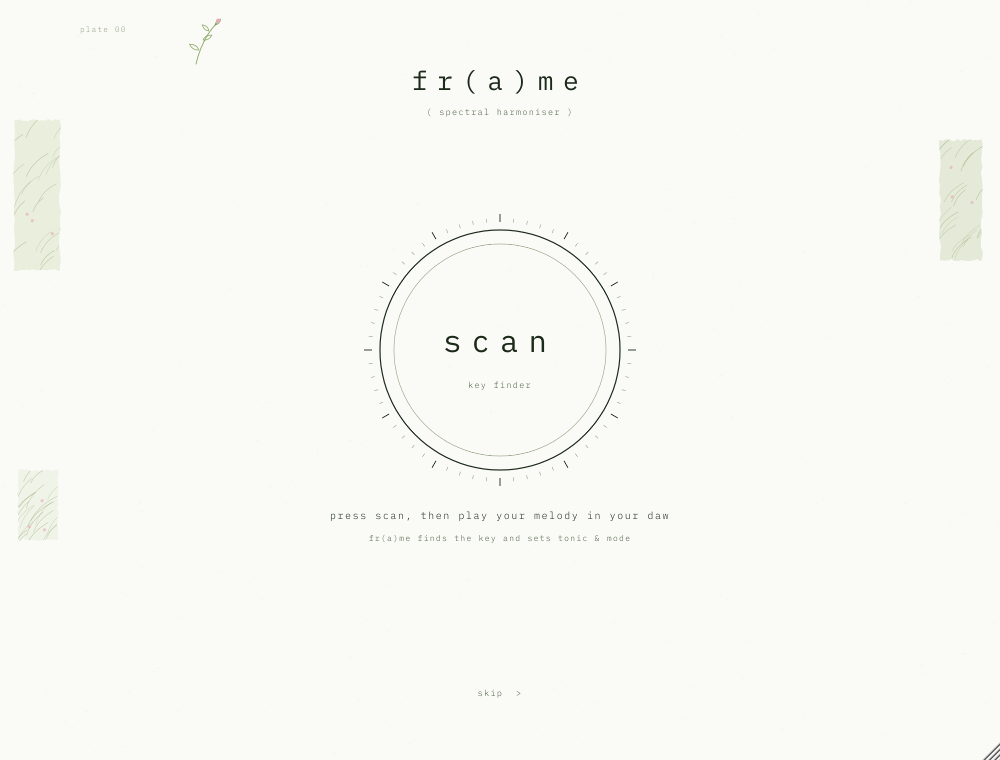

# fr(a)me — harmoniseur spectral

Plugin audio d'effet (VST3 · AU · Standalone) qui colore tout le son dans la gamme choisie
— notes de la gamme renforcées, espace entre elles creusé, harmoniques justes ajoutées —
**sans aucune latence** : l'effet sonne exactement en même temps que le son d'origine.

Contrôles : **scan** (page d'accueil : on joue la mélodie, fr(a)me trouve la tonalité et
règle tonique + mode), **harmo** (0–100 %, recalage des notes tenues + peigne + harmoniques),
**reverb** (0–100 %, réverbe ambient granulaire dans la tonalité), **gate** (trance gate
16 pas calé sur le tempo du DAW, 15 motifs, éteint au lancement), **mode** (major / minor), **tonic** (12 notes), **EQ façon Pro-Q**
dans la partie spectrum equalizer (coupe basse, 3 cloches, coupe haute) et **gain** de sortie
(−24 … +12 dB, petit bouton en haut à droite, à côté de **scan key**). Thème unique : garden.
Tous automatisables et sauvegardés avec le projet.

| page de scan (au lancement) | la planche |
|---|---|
|  |  |

## Télécharger

Les installeurs macOS et Windows sont compilés automatiquement par GitHub Actions et publiés dans
l'onglet **[Releases](../../releases/latest)** :

| système | fichier |
|---|---|
| macOS 11+ (Apple Silicon & Intel) | `frame-X.Y.Z-macos.pkg` — VST3, AU et Standalone, au choix |
| Windows 10/11 64 bits | `frame-X.Y.Z-windows-setup.exe` — VST3 et Standalone |
| Windows (portable) | `frame-X.Y.Z-windows.zip` |

Les installeurs ne sont pas signés par un certificat développeur payant :

- **macOS** : clic droit sur le `.pkg` ▸ *Ouvrir*, ou *Réglages Système ▸ Confidentialité
  et sécurité ▸ Ouvrir quand même*.
- **Windows** : à l'avertissement SmartScreen, *Informations complémentaires ▸ Exécuter
  quand même*. Le VST3 s'installe dans `C:\Program Files\Common Files\VST3\`.

Chaque push sur `main` recompile tout et met à jour la release `vX.Y.Z`, où X.Y.Z est la
`VERSION` du `project(...)` dans `CMakeLists.txt`. Pour une nouvelle version : changez ce
numéro et poussez (ou poussez un tag `vX.Y.Z`). Les installeurs de chaque run sont aussi
dans *Actions ▸ run ▸ Artifacts*.

Signature optionnelle (macOS) : `installer/macos/build_pkg.sh` signe avec vos identités
Apple si les variables `MACOS_APP_IDENTITY` et `MACOS_INSTALLER_IDENTITY` sont définies
(compte Apple Developer requis ; la notarisation se fait ensuite avec `xcrun notarytool`).

---

## 1. Prérequis

| | macOS | Windows |
|---|---|---|
| Système | macOS 11 ou plus | Windows 10 / 11 (64 bits) |
| Compilateur | Xcode 14+ (avec les *Command Line Tools*) | Visual Studio 2022 (charge de travail « Développement Desktop en C++ ») |
| CMake | 3.22+ (`brew install cmake`) | 3.22+ (inclus dans VS 2022, ou cmake.org) |
| Git | inclus avec Xcode | git-scm.com |

JUCE 8.0.15 est téléchargé automatiquement par CMake au premier lancement
(aucune installation manuelle). Pour travailler hors-ligne, clonez-le dans le dossier
du projet : `git clone --depth 1 --branch 8.0.15 https://github.com/juce-framework/JUCE.git JUCE`.

---

## 2. Compiler pas à pas

### macOS

```bash
cd frame
# 1. Générer le projet (Xcode) — binaire universel Apple Silicon + Intel
cmake -B build -G Xcode
# 2. Compiler en Release
cmake --build build --config Release
```

Résultats dans `build/Frame_artefacts/Release/` :

- `VST3/frame.vst3`
- `AU/frame.component`
- `Standalone/frame.app`

Installation :

```bash
cp -R build/Frame_artefacts/Release/VST3/frame.vst3     ~/Library/Audio/Plug-Ins/VST3/
cp -R build/Frame_artefacts/Release/AU/frame.component  ~/Library/Audio/Plug-Ins/Components/
killall -9 AudioComponentRegistrar 2>/dev/null   # force macOS à relire la liste des AU
auval -v aufx Frm1 Frma                           # validation AU (doit finir par « PASS »)
```

> Logic Pro : relancez Logic après la copie ; le plugin apparaît dans
> *Audio Units ▸ fr(a)me audio ▸ fr(a)me*.
> Pour un ordinateur autre que le vôtre, il faudra signer/notariser les bundles
> (`codesign` + `notarytool`) — inutile pour un usage personnel.

### Windows

Dans **« x64 Native Tools Command Prompt for VS 2022 »** (ou PowerShell) :

```bat
cd frame
:: 1. Générer la solution Visual Studio
cmake -B build -G "Visual Studio 17 2022" -A x64
:: 2. Compiler en Release
cmake --build build --config Release
```

Résultats dans `build\Frame_artefacts\Release\` :

- `VST3\frame.vst3`
- `Standalone\frame.exe`

Installation : copiez le dossier `frame.vst3` dans `C:\Program Files\Common Files\VST3\`
puis relancez un scan des plugins dans votre DAW. (L'AU n'existe que sur macOS.)

### Tester sans DAW

Lancez l'application **Standalone** : *Options ▸ Audio/MIDI Settings* pour choisir
l'entrée (micro, carte son) et la sortie. Pratique pour vérifier l'interface et le son.

### Banc de test du moteur (optionnel)

```bash
cmake -B build-tests -DFRAME_BUILD_TESTS=ON -DCMAKE_BUILD_TYPE=Release
cmake --build build-tests --config Release --target FrameEngineTest
# puis lancer l'exécutable FrameEngineTest (dans build-tests/FrameEngineTest_artefacts/…)
# avec un nom de dossier en argument pour obtenir des WAV avant / après :
#   FrameEngineTest wav
```

Résultats obtenus pendant le développement (48 kHz) :

| test | résultat |
|---|---|
| reconstruction sans recalage (latence déclarée exacte) | erreur à −138 dB |
| la#4 en la mineur → la4 | 440.02 Hz, aucun résidu ajouté |
| 480 Hz (si−49 cents, déjà dans la gamme) | intact, 479.98 Hz |
| changement de gamme pendant la lecture | aucune discontinuité |
| accord de scies désaccordées (pad) | énergie dont le demi-ton est dans la gamme : 66 % → 96 % |
| percussions : enveloppe 2 ms entrée/sortie | corrélation 0.98 (attaques conservées) |
| la3 tenu : harmoniques justes | ×2 à −9 dB, ×3 (mi) à −12 dB, ×4 à −14 dB ; la# hors gamme à −55 dB |
| bruit blanc (la mineur) | notes +6 dB, entre les notes −11 dB, niveau global −0.6 dB |
| salve de bruit, REVERB 70 % puis moteur | queue dans la gamme à 96 %, corrélation G/D 0.07, −39 dB à 1 s → −77 dB à 6 s |
| REVERB 100 % sur 40 s de bruit continu | niveau stable (pas d'emballement du nuage réinjecté) |
| bruit blanc → résonances, la mineur | la / do / mi ≥ −1.3 dB, hors gamme ≤ −18.5 dB, 81 % de l'énergie sur les notes, niveau conservé |
| bruit blanc → résonances, mi majeur | mi / sol# / si ≥ −4.1 dB, hors gamme ≤ −19.3 dB, 80 % sur les notes |
| vos hi-hats, chaîne complète | 90–92 % de l'énergie sur les notes de la gamme, hors gamme −25 à −41 dB, niveau identique |
| GATE | éteint = son strictement inchangé ; « pulse » : pas ouverts à 1.000, fermés à −91 dB, ouverture calée sur le temps (< 1 ms), aucun clic |
| HARMO à 0 | reverb, gate et EQ actifs ; tout à 0 → son d'origine (corrélation 0.999) |
| automation brutale HARMO / REVERB / GATE / EQ / GAIN / gamme | aucune valeur invalide (aussi sous AddressSanitizer, 44.1–96 kHz, blocs de 0 à 3072) |
| taille de bloc variable | sortie identique à l'échantillon près |

Une cible `FrameUiSnapshot` (même option) produit une capture PNG de l'interface.

---

## 3. Organisation du code

```
frame/
├── CMakeLists.txt            projet (JUCE téléchargé automatiquement)
├── Source/
│   ├── PluginProcessor.*     paramètres (APVTS), latence, mix dry/wet, état, bypass
│   ├── SpectralEngine.*      moteur spectral : STFT, vocodeur de phase, recalage, harmoniques, peigne, OLA
│   ├── AmbientReverb.*       réverbe ambient (FDN) + nuage granulaire réinjecté
│   ├── ProEq.*               EQ façon Pro-Q : coupes 24 dB/oct + 3 cloches (0 latence)
│   ├── TranceGate.*          GATE : 16 pas calés sur le DAW, 15 motifs (0 latence)
│   ├── PartialSnapper.*      recalage des partiels tenus sur la gamme (0 latence)
│   ├── ZeroLatencyHarmonizer.* peigne harmonique + harmoniques justes (0 latence)
│   ├── KeyDetector.*         SCAN : détection de la tonalité de l'entrée
│   ├── ScanPage.*            page d'accueil « scan »
│   ├── Scale.h               gammes (masque 12 notes) et note la plus proche
│   ├── LockFreeQueue.h       FIFO sans verrou audio → interface
│   ├── PluginEditor.*        la planche : mise en page, annotations, mise à l'échelle
│   ├── Visualisers.*         bandes sound (brut + traité) / spectrum / partials
│   ├── Controls.*            bascule major/minor, bouton « scan key », rangée des 12 notes, EQ façon Pro-Q (EqView)
│   └── FrameLookAndFeel.*    palette, typographie, potentiomètre
├── Resources/fonts/          IBM Plex Mono (licence SIL OFL, voir OFL.txt)
└── tests/                    banc de test du moteur, capture de l'interface
```

---

## 4. Le traitement en détail

**3.2 — harmo plus forte, et la floraison.** Réglée sur des morceaux longs (deux exemples
de 30 s comparés à Chroma : part de l'énergie sur les notes de la gamme, énergie « entre
deux notes », niveaux par bande), sans copier : fr(a)me garde son identité et y ajoute une
couche à lui.

- *Les basses aussi* : le recalage des partiels commence dès 50 Hz (avant 110 Hz) et le
  peigne est plein dès 200 Hz (avant 700 Hz) ; les basses fausses passent dans la tonalité.
- *Recalage plus large* : les partiels moins nets (tonalité ≥ 0.45 au lieu de 0.70) sont
  aussi recalés, les régions de chaque note sont élargies de 30 %, et un partiel partagé
  par deux bandes n'est déplacé qu'une fois (par la bande où il sonne le plus).
- *Relief* : +5 dB de présence sur les notes de la gamme autour de 1 kHz (courbe douce sur
  ±1.3 octave), pour que les lignes mélodiques ressortent.
- *Floraison* (nouveau) : un halo de résonateurs très fins (8 cents) sur chaque note de la
  gamme de 250 Hz à ~5 kHz, nourri par le son traité. Les notes tenues fleurissent et
  se prolongent un peu, chaque note respire lentement (0.1 – 0.35 Hz, ±18 %) et les notes
  sont réparties une à gauche, une à droite : l'accord s'ouvre dans la stéréo. Toujours à
  0 latence, stable (filtres passe-bande de gain 1), dosé par **harmo**.
- Mesuré sur les deux exemples : 98 % de l'énergie sur les notes de la gamme (88 % en 3.1),
  1.2 – 2.2 % entre deux notes (6 – 11 % en 3.1), contraste notes / hors-notes +2 à +3 dB.

**3.0 — l'harmonie sur les sons longs.** Toute la chaîne reste à **0 latence** (vérifié à
l'échantillon près sur un train de clics, avec et sans reverb, harmo à 0 ou 100 %).

- *Recalage des partiels tenus* (`PartialSnapper`) : pour chaque note de la gamme, une bande
  analytique mesure la fréquence réelle de ce qui y sonne. Si c'est un partiel tonal (sa
  phase reste cohérente sur 8 ms, contrairement à un bruit) qui appartient bien à cette
  bande, il est **remplacé par lui-même déplacé exactement sur la note** : les notes fausses
  ou « entre deux » deviennent des notes de la gamme au lieu d'être seulement atténuées. Les
  notes justes ne sont pas touchées (zone morte de ±6 cents), les bruits et les attaques
  passent tels quels. Mesuré : 455 Hz → 440.02 Hz (résidu −44 dB).
- *Peigne* : cloches à +27 dB plus larges (elles sonnent moins longtemps : plus de « lignes »
  qui traînent sur les sons tenus), compensation **statique** par octave calculée à partir de
  la réponse du peigne (les notes de la gamme ressortent au niveau d'origine) — l'ancienne
  régulation en boucle fermée faisait pomper le niveau sur les sons longs (jusqu'à ±13 dB) et
  déséquilibrait les graves ; elle est remplacée. Rattrapage très lent, limité à +6 dB, pour
  les sons non tonals (cymbales, bruits).
- *Harmoniques justes* poussées au maximum : octave ≈ −7 dB, douzième ≈ −11 dB, double
  octave ≈ −14 dB sous la note.

Mesures (partiels sur les notes de la gamme / entre deux notes) : extrait de la vidéo Chroma
en la majeur — Chroma 94 % / 4 %, fr(a)me 2.4 90 % / 0.4 % mais 9 % hors gamme, **fr(a)me
3.0 98 % / 2 %, 0.3 % hors gamme** ; mélodie « vocodex » en ré mineur 37 % → 95 % ; scie
tenue désaccordée de +39 cents 1 % → 99 % ; glissando 32 % → 100 % ; vibrato et accords
désaccordés recalés, niveau conservé à ±1 dB, plus de pompage. Traînées entre les accords
divisées par plus de deux (+6 dB au lieu de +10 dB).

**SCAN 3.1** (`KeyDetector`) : pendant un scan, on n'entend **que le son d'origine** (rien de
fr(a)me) ; une fois la tonalité trouvée et appliquée, l'effet revient en fondu (150 ms).
L'entrée est analysée par FFT (8192 points) : pics de 70 Hz à 5 kHz, **harmoniques écartées**
(×3, ×5, ×6, ×7 d'un pic plus grave — elles poussaient vers la quinte), **accordage estimé**
(histogramme à 10 cents : un sample à +35 cents n'est plus mal lu), puis score des 24
tonalités (profils d'Albrecht & Shanahan + part d'énergie dans la gamme + basse). ~8 s de son
joué. Sur 260 morceaux de test (mélodies seules, accords, arpèges, pentatoniques, 5 timbres,
accordages décalés jusqu'à ±45 cents) : la bonne gamme dans 88 % des cas (sur les 60
premiers : 90 %, contre 62 % pour le scan de la 3.0), la bonne tonalité parmi les 3
premières dans 94 % — les deux autres sont proposées en un clic
sur la page de scan. Les erreurs restantes sont surtout des mélodies pentatoniques ou des
arpèges de 3 notes, réellement ambigus.

**Analyse.** STFT à fenêtre de Hann, N = 4096 points à 44.1/48 kHz (8192 à 88.2/96 kHz,
16384 au-delà, pour garder ~11 Hz de résolution), recouvrement 75 % (hop = N/4).
L'analyse se fait sur le spectre *mid* (moyenne des canaux) ; le même déplacement est
ensuite appliqué à chaque canal, ce qui préserve l'image stéréo.

**Fréquence réelle des pics.** Vocodeur de phase : l'écart entre la phase mesurée d'un
bin et l'avance attendue entre deux trames donne la fréquence exacte du partiel, bien
plus précise que la largeur d'un bin.

**Recalage phase-locked** (Laroche & Dolson, 1999). Le spectre est découpé en régions
autour de chaque pic (jusqu'aux creux voisins). Pour chaque pic :

1. note cible = note de la gamme la plus proche (A4 = 440 Hz, tempérament égal) ;
2. toute la région est déplacée d'un nombre entier de bins vers la cible ;
3. elle est multipliée par un phaseur e^{jθ}, avec θ accumulé de trame en trame
   (θ += 2π·hop·(f_cible − f_réelle)/fs) le long du même partiel.

La fréquence entendue est donc exactement la cible, et la phase reste cohérente dans
le temps et entre les bins d'un même partiel : pas de son métallique ni de *phasiness*.
Comme on déplace les bins tels quels, l'enveloppe, le souffle et la texture de chaque
partiel voyagent avec lui — on ne resynthétise rien.

**Transitoires.** Seuls les partiels *stables* (suivis d'une trame à l'autre) sont
recalés. Le bruit, les attaques (+6 dB d'une trame à l'autre) et les partiels qui
viennent d'apparaître passent avec leur phase d'origine : kicks, caisses claires et
consonnes restent nets. L'infra-grave (< 25 Hz) et l'extrême aigu (> 16 kHz) ne sont
pas touchés.

**Modèle « Chroma » (mesuré).** Le traitement a été calé en analysant les comparaisons
avant/après de la démo vidéo de Chroma (Xynth) :

- *Recalage par demi-ton* : un partiel dont le demi-ton le plus proche est dans la gamme
  n'est pas touché (son désaccord naturel reste) ; sinon il est déplacé d'un nombre entier
  de demi-tons vers la note de la gamme voisine, en gardant la moitié de son écart en
  cents (mesuré : sol#+41 → la+27, do#−21 → ré−10, la#−19 → la−18).
- *Peigne harmonique* : renfort étroit sur les fréquences des notes de la gamme et creux entre
  elles, de ~250 Hz à 12 kHz, niveau global compensé, sans filtre qui sonne. Sur le même
  extrait passé dans fr(a)me et dans Chroma, l'écart moyen par note est d'environ 1.5 dB
  entre 600 Hz et 4 kHz, pour un niveau identique (−8.0 dB / −8.0 dB).

**Harmonie sans latence (toujours active, dans la lignée de la 1.4).** Depuis la 1.9, le
traitement audio se fait entièrement par filtres, comme un égaliseur en mode « zero
latency » : **0 échantillon de retard** (vérifié : la réponse à un clic culmine au
premier échantillon), FL Studio n'a rien à compenser.

- *Peigne harmonique* : une cascade de cloches étroites (double précision), une sur
  chaque note de la gamme de mi1 à mi8, puis un plateau de compensation dynamique
  (≈ 250 Hz – 9 kHz, boucle fermée) qui ramène le niveau : contraste notes / entre les
  notes ≈ 16 dB, comme la 1.4 poussée d'un cran ; le grave n'est pas touché.
- *Harmoniques justes* : chaque note de la gamme est isolée, son signal analytique
  z = A·e^{jθ} est formé, et ses harmoniques Re(z²)/A, Re(z³)/A², Re(z⁴)/A³ sont
  recréées (octave, douzième si la quinte est dans la gamme, double octave), en phase
  avec la note : ≈ −7 / −9 / −11 dB sous elle. Un détecteur « note centrée » (±50 cents)
  empêche les bandes voisines de fabriquer de fausses harmoniques (son propre).
- Changement de gamme : gains glissés (~120 ms), sans clic.

Le déplacement des notes fausses (vocodeur de phase des versions ≤ 1.8) demande
obligatoirement une analyse avec retard : il n'est plus utilisé pour le son. Le moteur
spectral sert désormais uniquement aux visualisations.

**EQ façon Pro-Q** (2.3, partie spectrum) : fréquences de gauche à droite (20 Hz → 20 kHz),
gain de haut en bas (±24 dB affichés), l'analyseur du son de sortie et les toniques de la
gamme en fond. Cinq points à tirer à la souris : **coupe basse** (carré ⟋, 24 dB/oct),
**3 cloches** (ronds 1 · 2 · 3 : gauche / droite = fréquence, haut / bas = gain ±18 dB,
molette = largeur Q 0.3 … 10) et **coupe haute** (carré ⟍). Double-clic sur un point : remise
à zéro. Coupes en butée et cloches à 0 dB : son strictement inchangé. 0 latence (filtres à
variables d'état), automatisable, placé juste avant le limiteur de sortie. La courbe affichée
correspond au son (cloche +12 dB mesurée à +12.0 dB).

(Le **retune** des versions 2.0 à 2.2 a été retiré en 2.3.)

**HARMO** (ancien MIX, 0–100 %) : dose uniquement le traitement harmonique (peigne +
harmoniques justes) ; à 100 % le son est celui de la 2.0.0. À 0 %, la réverbe, l'EQ,
le gate et le gain fonctionnent toujours : chaque bouton agit seul, et ensemble ils
s'enchaînent dans cet ordre — reverb → harmo → gain → EQ → gate — pour que tout ce qui
est ajouté (queue, porteuses) passe dans la gamme.

**GATE 3.3** (à la place du pitch, retiré) : trance gate qui coupe le son sur les temps.
- 16 pas par mesure (doubles croches), calés sur la position et le tempo du DAW ;
  transport arrêté : il tourne seul au tempo du DAW (120 par défaut) ;
- **éteint au lancement** ; « off / on » (ou un clic sur le motif) pour l'allumer quand on
  veut ; ‹ › pour changer de motif : bloom, pulse, flutter, gallop, offbeat, pump, chop,
  morse, dotted, tresillo, heart, ripple, swell, sparkle, drift ;
- chaque pas a son niveau (certains motifs ont des pas à moitié ouverts ou en rampe) et
  une longueur d'ouverture propre au motif ; ouverture ~1 ms, fermeture ~4 ms : net, sans
  clic ; allumer, éteindre ou changer de motif se fait en fondu (20 ms) ;
- appliqué au son traité, en fin de chaîne, à 0 latence (un simple gain).

**Thème** : un seul, garden — fond blanc, encre de mousse, vert d'herbe, quelques touches de
rose ; trois aplats d'herbe couchée dans les marges et un brin au crayon.

**REVERB** (0–100 %) : vraie réverbe ambient — réseau de 8 lignes à retard en feedback
(matrice de Hadamard), longueurs modulées lentement (queue vivante, pas métallique), aigus
amortis, pré-délai, T60 de 1.5 s à 12 s. Un **nuage granulaire** vit *dans* la réverbe :
des grains de 80 à 350 ms prélevés dans la queue, à l'unisson ou à l'octave (au-dessus ou
en dessous), placés au hasard dans l'espace stéréo, puis réinjectés dans la réverbe où ils
se fondent. La réverbe est placée **avant** le moteur harmonique : toute la queue, grains
compris, est ensuite recalée, harmonisée et peignée → une réverbe entièrement dans la
tonalité. Niveau normalisé : la queue ne s'emballe pas, même à 100 % sur un son tenu.

**Particules (1.9)** : nuage plus dense (6 → 46 grains/s), éclats courts (30–90 ms) et
grains longs (120–420 ms), unisson / octave / double octave au-dessus / octave en dessous,
diffusion propre, filtre anti-repliement ; réinjection dans la réverbe stable par
construction (seules les particules transposées reviennent dans la boucle, énergie
plafonnée par rapport au son entrant). Niveau de la réverbe calé sur la 1.4.

**Limiteur de sortie** : gain lissé lié en stéréo (attaque immédiate, relâchement
120 ms, plafond −0.5 dBFS) au lieu d'un écrêtage : plus de grésillement près de 0 dB.

**Garde-fou « tout le son passe »** : le plugin compare en continu l'énergie du son
traité à celle du son d'origine (aligné). Si le traité tombe à plus de 6 dB sous
l'original alors que celui-ci joue, le son direct est réinjecté automatiquement (en ~30 ms,
retrait en ~600 ms) : aucune partie du son ne peut disparaître, quel que soit l'hôte. En
usage normal il ne s'active jamais (vérifié : 0 bloc actif sur des hi-hats et 60 s de
musique) ; sur une perte simulée de 30 dB, il rétablit le niveau d'origine. (Depuis la 2.2,
le pied de page est retiré : la planche reste épurée.)

**Sécurité** : entrée et sortie assainies (aucune valeur invalide ne peut sortir ni
contaminer le mixeur de l'hôte), auto-réinitialisation du moteur si besoin, limiteur doux
transparent sous −1 dBFS qui plafonne la sortie à 0 dBFS, appels de l'hôte avant
`prepareToPlay` ou avec des blocs vides gérés.

**Resynthèse.** IFFT, fenêtre de synthèse de Hann, overlap-add normalisé
(reconstruction parfaite quand rien n'est déplacé).

**Latence.** Aucune (0 échantillon) depuis la 1.9. Le signal sec est retardé
d'autant, si bien que le MIX ne crée jamais de filtrage en peigne. En bypass, la
latence est conservée.

**Sans clic.** MIX lissé sur 50 ms ; un changement de gamme est fondu sur ~100 ms
(les cibles glissent d'une note à l'autre, θ reste continu).

**Temps réel.** Toute la mémoire est allouée dans `prepareToPlay`. Le thread audio
n'alloue rien et ne prend aucun verrou ; les formes d'onde et les trames spectrales
partent vers l'interface par deux `LockFreeQueue` (juce::AbstractFifo). Coût mesuré :
environ 2.5 % d'un cœur en stéréo à 48 kHz (build Release).

---

## 5. L'interface

Une planche d'analyse de 1000 × 760 unités, dessinée en vectoriel et mise à l'échelle
(720 px de large par défaut ; redimensionnez par le coin inférieur droit, de 520 à 1500 px).

- **sound** : le son brut (gris) et le son dans la tonalité (vert) superposés ;
- **spectrum equalizer** : EQ façon Pro-Q (fréquences de gauche à droite) sur l'analyseur du son de
  sortie, avec la tonique de chaque octave ;
- **partials** : partition graphique noire, un rond par pic détecté (taille = amplitude),
  vert si le pic a été recalé ;
- en bas : **harmo** (double-clic = 100 %), **reverb** (double-clic = 30 %), le **gate**
  (‹ nom du motif ›, les 16 pas avec le pas joué en vert foncé, off / on) ; **mode** (clic sur le mot) ; **tonic** (clic ou glisser le long de la rangée ; un point
  marque chaque note de la gamme) ;
- en haut à droite : **scan key** (rouvre la page de scan) et **gain** (double-clic = 0 dB).

3.4 : contrôles réorganisés et aérés — bande partials plus basse, contrôles remontés dans
la place libérée, trois groupes espacés : son (harmo, reverb), gate, tonalité (mode
au-dessus de la tonique) ; « spectrum » devient « spectrum equalizer ».

3.2 : planche épurée — une seule bande de son au lieu de deux, plus d'échelles ni de
rappels sur les bandes, scan key monté à côté du gain.

À l'ouverture d'une nouvelle instance, la **page de scan** s'affiche : gros bouton « scan »,
on joue la mélodie dans le DAW, la tonalité est trouvée et appliquée, puis la planche
s'ouvre (bouton **skip scan** pour entrer directement).

3.2.1 : **tant que le scan n'est pas lancé et terminé (ou passé avec skip scan), fr(a)me
laisse passer le son d'origine à l'identique**, sans effet ni décalage ; l'effet arrive en
fondu de 150 ms avec la tonalité trouvée. L'état est sauvegardé avec le projet (les projets
d'avant 3.2.1 restent actifs comme avant).

Les bandes partagent le même axe temporel (~9 s, « now » à droite).

---

## 6. Personnaliser

- Couleurs : `Palette` dans `Source/FrameLookAndFeel.h`.
- Taille de FFT : `SpectralEngine::prepare` (plus grand = graves plus précis mais plus
  de latence et d'étalement temporel).
- Seuil « stable / attaque » : section 5 de `SpectralEngine::processFrame`.
- Mineur = mineur naturel (éolien) ; les gammes sont définies dans `Source/Scale.h`.
